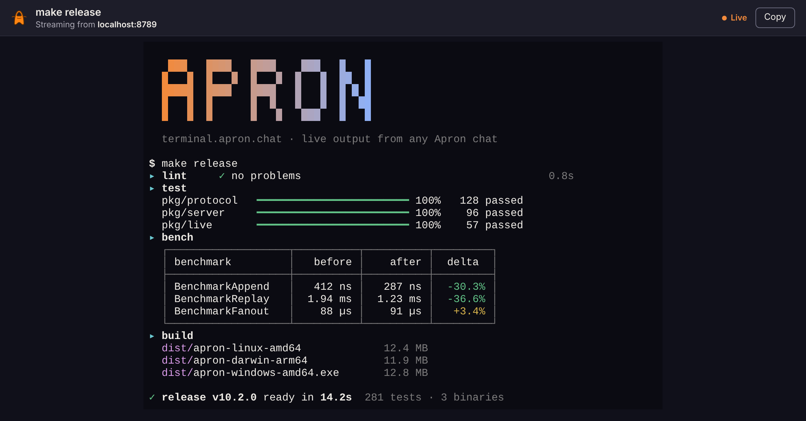
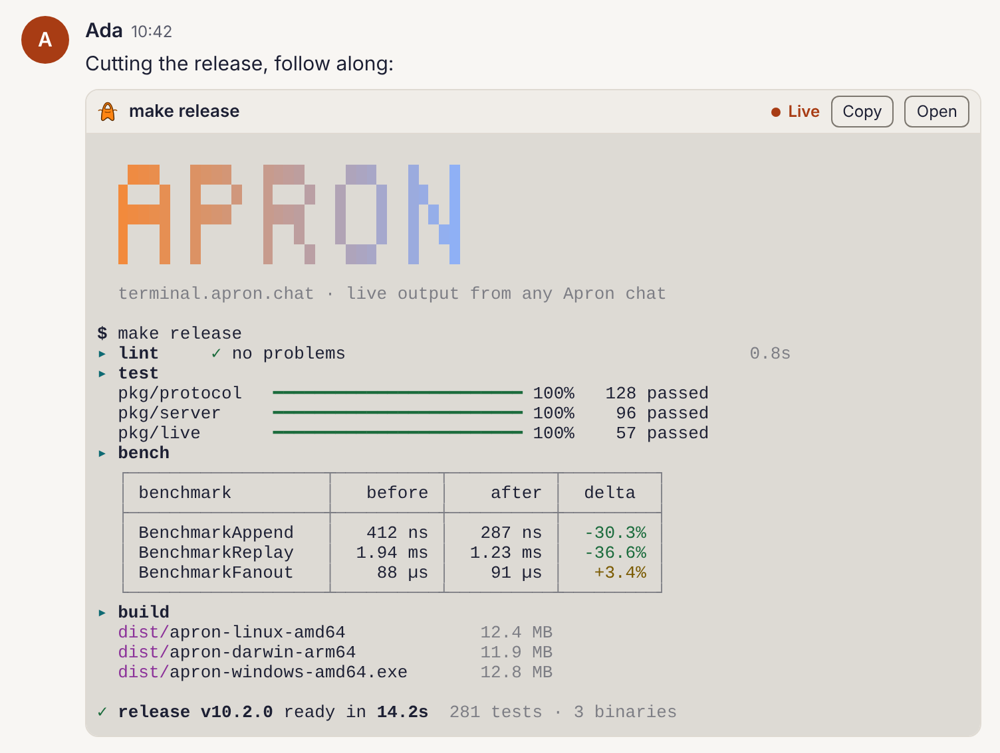

# terminal.apron.chat

Apron Embedded Terminal: a stand-alone viewer for the live output of Apron `terminal` embeds
([PROTOCOL.md §4.8.6](https://github.com/shazow/apron/blob/main/PROTOCOL.md#486-embedterminal)).
Open a terminal in any browser, or [embed it in an iframe](#embedding) in a
chat client that doesn't draw terminals itself.

```text
https://terminal.apron.chat/#stream=https://chat.example/t/p3Wn9d…&title=make%20test
```



The page reads the stream and draws it the way web.apron.chat's terminal viewer
does: xterm.js at 80 columns by 40 rows, scaled to fit, with scrollback. It
follows the output live, reconnects when the connection drops, and keeps
showing what arrived once the output ends.

## Links

| key      |          | what |
|----------|----------|------|
| `stream` | required | the embed's `url`: the live text that the chat server serves. Optional with `embed=1` |
| `cast`   | in place of `stream` | an asciicast (version 3) to replay, such as one saved here ([Recordings](#recordings)) |
| `title`  | optional | the embed's `title`, such as the command |
| `embed`  | optional | `1`: the compact layout for a chat message ([Embedding](#embedding)) |
| `theme`  | optional | `light` or `dark`, to match the client; the system's unless set |

- Put the keys in the fragment, after `#`. The stream's address is all anyone
  needs to read it, and the fragment never reaches this site's host. A link
  with `stream` in the query is refused, since the address has already been
  sent.
- Percent-encode a value that contains `&`, `#`, `+` or `%`. `:` and `/` can
  stay as they are.
- If a key is repeated, the first value is used.
- `stream` must be `https:`. An address with a user name or password is
  refused.
- Plain `http:` to `localhost`, names under it, or `127.0.0.1` works only in a
  copy of the page that is itself on localhost, such as `npm run dev`, for
  local development. terminal.apron.chat refuses it, and its CSP doesn't allow
  it. Otherwise a link could make every viewer's browser read services running
  on their own machine.

`viewerUrl` in [`src/stream.js`](src/stream.js) builds a link. A server can
build the same thing in one line:

```js
`https://terminal.apron.chat/#stream=${encodeURIComponent(url)}${title ? `&title=${encodeURIComponent(title)}` : ''}`
```

## What the page does with a stream

- It reads `GET <stream>` with `fetch`. It sends no cookies, no credentials and
  no referrer. Live text is served with `Access-Control-Allow-Origin: *`
  (§4.8.5), so it needs nothing else. The page decodes the bytes as UTF-8, as
  the server does for the output it keeps.
- It shows the stream as the protocol's clients do. Each response starts from
  a fresh terminal, a line feed also returns to the first column, and the page
  never performs a control function that acts outside the screen. Window
  titles (OSC 0–2) and clipboard writes (OSC 52) are ignored. OSC 8 links are
  shown but never opened.
- If a read fails or drops, it tries again after 1, 2, 4, 8, then every 15
  seconds, and the new response replaces what was shown. It waits at least as
  long as the server's `Retry-After` asks, up to a minute. A 4xx other than
  408 or 429 stops it, because every try counts against the server's limits
  on readers.
- When the terminal is out of sight for 15 seconds (its tab hidden, or its
  frame scrolled out of view), it stops reading. It reads afresh when it's
  back in sight, so it doesn't hold one of the server's few reader places for
  nobody.
- When the response ends, the output has ended. The page keeps what it showed.

Chat servers differ once the output has ended. apron-server-go keeps serving
the finished output at the same address. apron-server-cloudflare answers 404,
and the page then says the stream has ended and points to the chat message,
which shows the final output.

Servers also limit who reads a stream. apron-server-cloudflare allows 5 to 10
readers at a time. When they are full it answers 429 with `Retry-After`; the
page says there are too many readers and tries again when asked. It also
limits how many times a stream is read in all (15 to 30). Past that it answers
403, and the page stops and points to the chat message.

## Recordings

The page saves what it shows, and opens it again, in the formats of tools
that already exist, rather than one of its own:

- **Save → asciicast** writes the output as it arrived, with its timing, as
  an [asciicast v3](https://docs.asciinema.org/manual/asciicast/v3/) (`.cast`):
  asciinema's recording format. Attach one to a bug report, replay it with
  `asciinema play`, or open it here.
- **Save → VHS golden** writes the screen as it is now, as a
  [VHS](https://github.com/charmbracelet/vhs) golden file (`.txt`): each row
  without trailing spaces, then a line of 80 `─`. Compare it in tests, as VHS
  users do.
- **Opening** a recording: drop a file on the page, use **Open a file**, or
  link to one with `#cast=<https url>`, which is read as `stream` is. An
  asciicast replays at its own pace, with pauses cut to its `idle_time_limit`
  (2 seconds without one), and **Skip** shows the end. It keeps its own
  terminal size. Any other file shows as a terminal's output, such as a
  finished embed's `output`. A file stays in your browser.

It opens asciicasts of version 3 only, which asciinema 3 records; `asciinema
convert` converts older ones. A long stream is recorded up to about 1 MB of
output; past that, the recording keeps the last part, as servers do. Save
isn't offered in a frame, where Open leads to the full page.

## Embedding

A client that doesn't parse terminal output itself can show a `terminal`
embed by putting this page in an iframe, in place of its own screen. In a
frame, the page switches to a compact layout for a chat message:



- a slim bar with the title, Live, Ended or Finished, Copy, and Open (the full
  page in a new tab, with scrollback);
- the screen, as large as the frame's width allows (down to a 4 px font on a
  phone), showing only the rows written, like web.apron.chat's terminal
  embeds. It keeps no scrollback, so a wheel or swipe over it scrolls the
  client's page.

```html
<iframe
  src="https://terminal.apron.chat/#stream=https://chat.example/t/p3Wn9d…&title=make%20test&embed=1&theme=dark"
  sandbox="allow-scripts allow-popups allow-popups-to-escape-sandbox"
  allow="clipboard-write"
  title="make test"
  style="width: 100%; height: 120px; border: 0"></iframe>
```

- Build `src` from the embed's `url` and `title` as in [Links](#links). Add
  `embed=1`; a framed page uses the compact layout anyway, but the key also
  makes a native app's WebView use it. Add `theme` if your client has its own
  light and dark.
- `sandbox="allow-scripts"` is all the page needs. The page doesn't need
  `allow-same-origin`, and it's safer without it. `allow-popups` and
  `allow-popups-to-escape-sandbox` let Open start the full page in a normal
  tab. `allow="clipboard-write"` lets Copy work.
- The frame reads the stream itself, straight from the chat server and
  without credentials, so the client doesn't need any code for live text.

### Messages

The page talks to the window that frames it with `postMessage`. It listens
only to its parent window (`event.source`), whatever its origin, and what it
sends is never secret: no address and no output.

| direction | message | when |
|-----------|---------|------|
| frame → client | `{type: "apron-terminal:ready"}` | it is listening. Send (or resend) the output on this |
| frame → client | `{type: "apron-terminal:height", height}` | the height its content needs, in CSS pixels, changes |
| client → frame | `{type: "apron-terminal:output", output}` | a snapshot has given the embed its `output` |

- **Height:** an iframe can't size itself. Set the frame's height to
  `height`, or leave the frame at a fixed height. The page then scrolls inside
  it.
- **Output:** when the output ends, the server replaces the embed's `url`
  with `output` (§4.8.6). Some servers stop serving `url` then
  (apron-server-cloudflare answers 404), so a frame that is still open, or one
  opened later, has nothing left to read. Send it `output`. It stops reading
  the stream and shows the output from a fresh terminal, as Finished. For an
  embed that is already finished when you show it, leave `stream` out of the
  link (`#embed=1&title=…`) and send `output` on `ready`.
- **Changing the address:** an iframe whose `src` changes only after the `#`
  doesn't reload, but the page notices and starts afresh. It sends `ready`
  again, so send the output again too. A change of `theme` alone keeps what it
  shows. To show the output of a terminal that has just finished, send
  `output` rather than change `src`.
- **Hybrid apps:** `frame-ancestors *` matches pages on `http:` and `https:`
  only. An app whose own pages are on `file:` or a custom scheme, such as
  Tauri's or Capacitor's, can load the page in a WebView instead
  ([Native apps](#native-apps)).

```js
// One listener for every terminal frame on the page.
addEventListener('message', (event) => {
	const frame = [...document.querySelectorAll('iframe.apron-terminal')].find((f) => f.contentWindow === event.source);
	if (!frame || typeof event.data !== 'object' || event.data === null) return;
	if (event.data.type === 'apron-terminal:height') frame.style.height = `${event.data.height}px`;
	if (event.data.type === 'apron-terminal:ready') sendOutput(frame);
});

// On ready, and when a snapshot gives the embed its output.
function sendOutput(frame) {
	const output = outputFor(frame); // the embed's `output`, once it has one
	if (typeof output === 'string') frame.contentWindow.postMessage({ type: 'apron-terminal:output', output }, 'https://terminal.apron.chat');
}
```

### Native apps

Load the same address in a WebView, with `embed=1`. With no parent window
around it, the page sends no messages: measure its height with the WebView's
own APIs. To show the output, run this in the page once it has loaded, from the
app (for example with `evaluateJavaScript`):

```js
window.postMessage({ type: 'apron-terminal:output', output: "…" }, '*')
```

The page takes the message because its parent, with no frame around it, is
the page itself.

### Trust

The frame runs code served by terminal.apron.chat, and that code is given the
stream's address. If you'd rather not depend on this site, host the page
yourself: `npm run build` writes static files to `build/`. Serve them with the
headers in `build/_headers`, and point your iframes there.

## Security

- The site is files only, with no server code. The page loads nothing from
  another origin, and builds all its markup with DOM calls.
- Any page may show it in a frame (`frame-ancestors *`): it has nothing to
  click that acts on its viewer's behalf. Its files are served with
  `Access-Control-Allow-Origin: *`, because in a sandboxed iframe its origin
  is opaque, and module scripts load with CORS.
- The Content-Security-Policy (in `_headers`, from
  [`scripts/build.mjs`](scripts/build.mjs)) allows only the page's own scripts.
  It forbids the DOM's HTML sinks (Trusted Types), and lets the page connect
  only to `https:`. The development server also allows localhost over
  `http:`.
- Inline styles are allowed, because xterm.js sizes and colors its screen with
  `<style>` elements and `style` attributes. No markup can come from a stream:
  its text only ever reaches xterm's cells.
- The full page shows which host it streams from, so that output can't pass
  itself off as coming from somewhere else. In a frame it doesn't: the client
  that embeds it chose the stream. Links in a frame open in a new tab, never
  in the frame. Titles are cleaned up before they are
  shown: they're kept on one line, controls that could reorder the text around
  them are removed, and they're cut to 120 characters.

## Development

You need Node 22 or later. The only dependency is xterm.js, pinned to the
version that apron-web uses.

```sh
npm ci
npm test               # link parsing, stream reading, screen sizing, the terminal fixtures, and build checks
npm run dev            # build, then serve at http://localhost:8789 with production's headers, plus localhost streams
DEMO=1 npm run dev     # the same, with a demo stream at /demo (scripts/demo.mjs) and a link to view it
npm run build          # write the site to build/
```

| path | what |
|------|------|
| `src/stream.js` | reads and writes links: the stream's address and title, with their checks |
| `src/live.js` | follows a stream: reads, reconnects, decodes |
| `src/screen.js` | the terminal screen: xterm.js, fitted to the window or the frame, with or without scrollback |
| `src/embed.js` | the page in an iframe: the messages it sends and takes |
| `src/formats.js` | recordings: reads and writes asciicast v3, writes VHS golden files |
| `src/app.js` | the page |
| `scripts/demo.mjs` | the demo run: colors, a banner, progress bars and a table, as a program writes them |
| `scripts/screenshot.mjs` | takes `docs/screenshot.png` and `docs/embed.png` of the demo, live |
| `scripts/build.mjs` | builds `build/`: the page, `xterm.mjs` and `xterm.css` from `node_modules`, and `_headers` |

### Terminal fixtures

`npm test` replays the terminal fixtures in shazow/apron
([`tests/fixtures/terminal.json`](https://github.com/shazow/apron/blob/main/tests/fixtures/terminal.json)):
outputs, and the screens that clients show for them (PROTOCOL.md §4.8.6).
`test/fixtures.test.mjs` writes each one to a headless xterm.js
(`@xterm/headless`), made with the same options and the same handlers for
titles and the clipboard as the page's screen (`behaviorOptions` and
`swallowOutsideControls` in `src/screen.js`), then compares the screen.
It writes each case twice: all at once, and a character at a time, as a live
stream may split it anywhere.

The fixtures come from the `protocol` submodule, pinned to a commit, which
`npm test` checks out first (`pretest`: `git submodule update --init`).
Dependabot opens a pull request when it moves, so CI runs the page against new
fixtures before they're adopted. To update by hand, run
`git -C protocol fetch origin main`, check out the commit you want, and commit
`protocol`.

`src/live.js` and `src/screen.js` follow apron-web's
`src/lib/protocol/live-text.ts` and `src/lib/ui/terminal-screen.ts`. When you
change how terminals look or read in one place, change the other to match.

### Screenshots

`docs/screenshot.png` and `docs/embed.png` are the demo run, streamed live
and held open, taken in Chromium. After changing how the page looks, retake
them:

```sh
npm install --no-save playwright && npx playwright install chromium
node scripts/screenshot.mjs
```

## Deploying

[`.github/workflows/ci.yml`](.github/workflows/ci.yml) runs `npm test` on
every pull request and on `main`, with the `protocol` submodule.

The site is a Cloudflare Worker with static assets only, like link.apron.chat:
the Worker `terminal-apron-chat`, on the custom domain `terminal.apron.chat`.
`wrangler.toml` has no `main`, so no Worker code runs, and `npm test` fails if
one is added.

Workers Builds deploys it on every push to `main`, which is to say on every
merge. Other branches, such as a pull request's, get a preview at
`<branch>-terminal-apron-chat.shazow.workers.dev`.

One-time setup, in the Cloudflare dashboard:

1. **Workers & Pages** → **Create** → **Import a repository**, and choose
   `apron-chat/terminal.apron.chat`.
2. Set the project name to `terminal-apron-chat`. It must match `name` in
   `wrangler.toml`.
3. Leave **Build command** empty. Wrangler runs `npm test && npm run build`
   before every deploy and preview (`[build]` in `wrangler.toml`), so a
   failing test stops it whatever the dashboard says, and `npm test` checks
   out the fixtures in `protocol/` first. Workers Builds installs the
   dependencies itself (`npm ci`, with the npm version in `packageManager`).
4. Leave **Deploy command** as `npx wrangler deploy`, the production branch as
   `main`, and builds for non-production branches on.
5. Deploy. The first deploy creates the custom domain `terminal.apron.chat`
   (from `routes` in `wrangler.toml`) and its DNS record.

To check the config without deploying:

```sh
npm run build && npx wrangler deploy --dry-run   # reads build/, parses _headers
npx wrangler dev                                 # serves build/ as Cloudflare does, at http://localhost:8787
```
